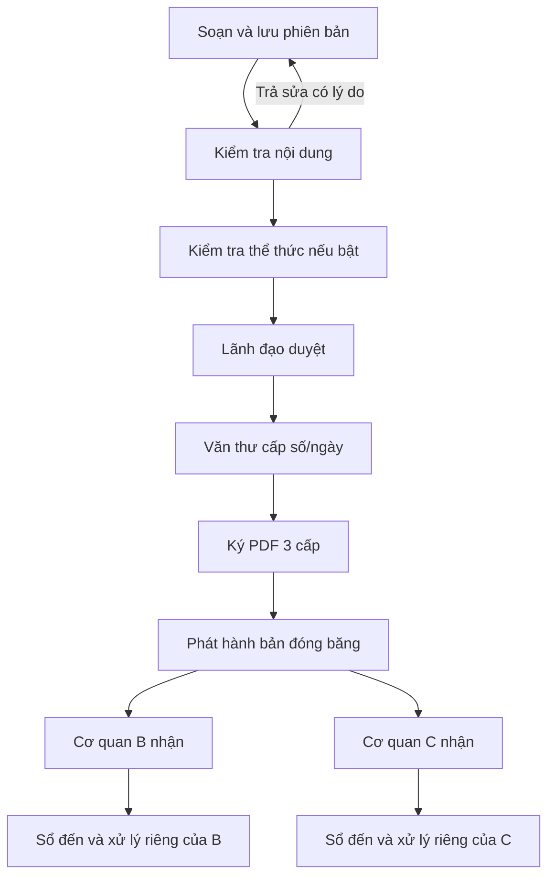

# Thiết kế chức năng Hành trình văn bản

## 1. Mục tiêu

Từ một văn bản bất kỳ, người dùng được phép biết:

1. Văn bản do cơ quan nào tạo, số/ký hiệu, phiên bản đang được xử lý.
2. Đã qua bước nào, lúc nào, ai duyệt, đã trả sửa bao nhiêu lần và lý do gì.
3. Việc đang nằm ở ai, hạn xử lý, có quá hạn hay không, bước kế tiếp.
4. Đã phát hành tới những cơ quan nào, giờ gửi, trạng thái gửi/nhận/từ chối và lý do.
5. Bên nhận có biên nhận riêng; bên gửi **không** được mở nghiệp vụ xử lý nội bộ của bên nhận.

## 2. Bảng dữ liệu phục vụ màn hình

| Bảng | Vai trò | Thuộc tính chính |
|---|---|---|
| `VanBan` | Văn bản gốc theo cơ quan sở hữu | `MaVanBan`, `MaCoQuan`, `TrangThai`, `PhienBanHienTai` |
| `PhienBanVanBan` | Snapshot bất biến sau mỗi lần sửa | `SoPhienBan`, `LyDoThayDoi`, `ThoiDiemTao` |
| `TacVuXuLy` | Ai đang giữ việc, hạn và bước hiện tại | `Buoc`, `MaNguoiDuocGiao`, `HanXuLy`, `TrangThai` |
| `QuyetDinhXuLy` | Duyệt/trả sửa có lý do | `KetQua`, `LyDo`, `SoPhienBan` |
| `ChuKySo` | Kết quả ký/xác minh mật mã | `LoaiChuKy`, `DuLieuChuKy`, `KetQuaXacMinh` |
| `BanPhatHanh` | Bản đóng băng được gửi đi | `MaPhatHanh`, `SoPhienBan`, `MaBamBanCuoi` |
| `LuotChuyenVanBan` | Một hàng cho mỗi cơ quan nhận | `MaCoQuanGui`, `MaCoQuanNhan`, `ThoiDiemGui`, `ThoiDiemNhan`, `TrangThai` |
| `LichSuVanBan` | Dòng thời gian không ghi đè | `HanhDong`, `MoTa`, `MaNguoiThucHien`, `ThoiDiem` |
| `VanBanDen` | Sổ và trạng thái của riêng cơ quan nhận | `MaCoQuanNhan`, `SoDen`, `TrangThai` |

## 3. Quy trình nghiệp vụ

*Ghi chú:* Bước ký PDF, phát hành, luồng xử lý sâu bên nhận đang nằm trong kế hoạch triển khai tiếp, chưa được gọi là hoàn thành.

## 4. Quy tắc bảo mật màn hình và API

- Menu **Hành trình** chỉ hiện nếu API trả `documents.read`.
- Tại `GET /api/v1/documents/{id}/timeline`, kiểm tra đăng nhập, quyền nghiệp vụ, cơ quan, người tạo/người nhận việc và độ mật. Trả `404` nếu văn bản không nằm trong phạm vi.
- Người gửi thấy `LuotChuyenVanBan` và sự kiện phạm vi `GIAO_NHAN`; không thấy `TacVuXuLy`, `QuyetDinhXuLy`, hay kết quả nội bộ của cơ quan B/C.
- Cơ quan nhận có `VanBanDen` riêng, không được gọi endpoint revision của cơ quan gửi.
- Thời gian sự kiện lưu `DATETIME2(3)` theo UTC; UI hiển thị theo giờ địa phương.
- Trạng thái gửi và phát hành **khác nhau**; lỗi giao hàng không làm mất bản đã phát hành.

## 5. Ví dụ minh họa trong UI

`VB-20261124-A001` được dựng sẵn (chỉ trong chế độ mô phỏng):

1. Cơ quan A soạn v1.
2. Trưởng phòng trả sửa vì thiếu phụ lục, cập nhật v2.
3. Lãnh đạo duyệt, văn thư cấp số 128/KH-CQA.
4. Ký ba cấp (dòng sự kiện **mô phỏng**, không phải chữ ký mật mã học).
5. Phát hành tới B và C.
6. B tiếp nhận lúc 23/11/2026; C đang chờ biên nhận.

Trong bản API thực, các trạng thái giao nhận phải sinh từ transaction/server thật và bằng chứng chữ ký đã kiểm chứng.
